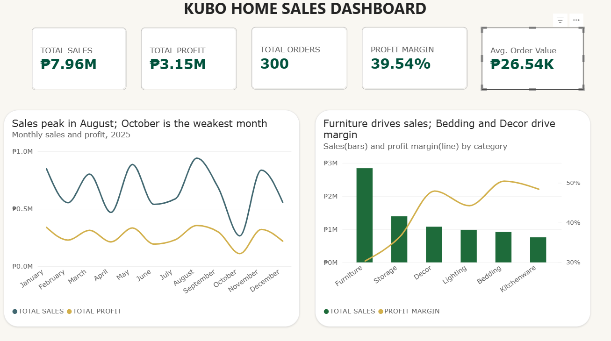
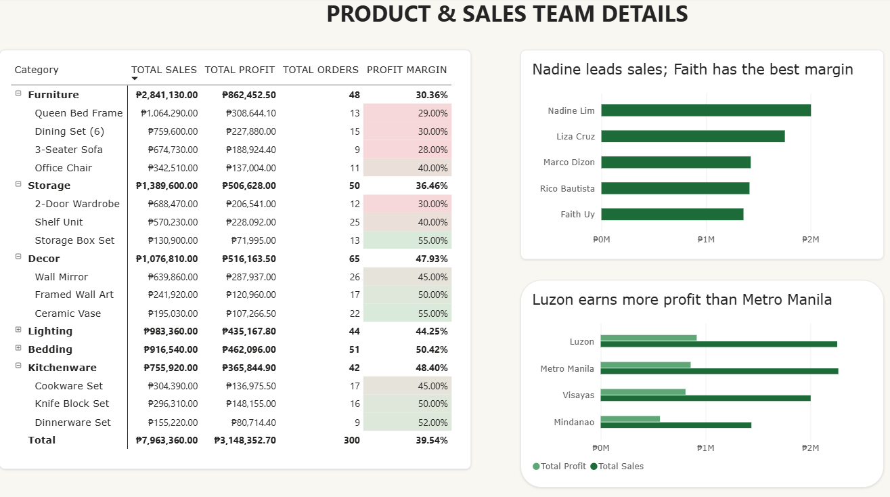

# 🛋️ Kubo Home Sales Dashboard
### Which products, regions and sales reps actually drive profit?


> **A sales analytics case study** for a fictional home-goods retailer (training dataset from my data analytics masterclass). The goal: go beyond "total sales" and find what **drives profit**.




---

## 📌 TL;DR
| | |
|---|---|
| **Sales** | ₱7.96M total · ₱3.15M profit · **39.5% margin** · 300 orders |
| **Biggest seller** | **Furniture** (₱2.84M, 36% of sales), but it has the **lowest margin (30%)** |
| **Profit drivers** | **Bedding (50%)** and **Decor (48%)** have the highest margins |
| **Surprise** | **Luzon earns more profit than Metro Manila** on nearly equal sales |

---

## 1. The problem
A sales dashboard that only shows revenue rewards the wrong things. Management needed to know:
1. **When** are sales strongest and weakest?
2. **Which categories and products** bring in sales, and which bring in **profit**?
3. **Which reps and regions** perform best on profit, not just volume?

## 2. Data
300 orders from 2025 (one row per order): date, product, category, region, sales rep, sales and profit.
*Practice dataset provided in a data analytics course, not real company data.*

## 3. Method
- **Power BI** data model with DAX measures:
  ```DAX
  Total Sales     = SUM(Sales[Sales])
  Total Profit    = SUM(Sales[Profit])
  Profit Margin   = DIVIDE([Total Profit], [Total Sales])
  Avg Order Value = DIVIDE([Total Sales], DISTINCTCOUNT(Sales[OrderID]))
  ```
- **Combo chart:** sales (bars) plus margin (line, secondary axis).
- **Matrix with conditional formatting:** low-margin products in red, high-margin products in green.
- **Insight titles:** every chart title states the finding, not just the topic.

## 4. Key findings
1. **Sales peak in August (₱941K)** and drop to their **lowest in October (₱264K)**.
2. **Furniture is a volume trap:** it's the biggest category, but has the lowest margin (30%). The **Queen Bed Frame** alone brings ₱1.06M at a 29% margin.
3. **Bedding (50%) and Decor (48%)** bring in the most profit per peso.
4. **Nadine Lim leads in sales; Faith Uy has the best margin.** Top seller ≠ top earner.
5. **Luzon makes more profit than Metro Manila** on nearly equal sales.

## 5. Recommendations
- **Review furniture pricing and discounts.** A few margin points on ₱2.8M of sales is worth more than any campaign.
- **Bundle high-margin Bedding and Decor** with furniture purchases.
- **Plan an October promotion** to soften the weakest month.
- **Reward reps on profit, not just sales**, and study what drives Faith Uy's margins.

## 6. Files in this repo
| File | Contents |
|---|---|
| `Kubo_Home_Sales.pbix` | Power BI dashboard (2 pages) |
| `kubo_overview.png`, `kubo_details.png` | Dashboard screenshots |

---
**Jarred Tañedo** · Mechanical Engineering faculty → Data Analyst
🔗 [LinkedIn](https://www.linkedin.com/in/jarred-jeff-bandong-ta%C3%B1edo-367667354) · 🌐 Portfolio *(coming soon)*
